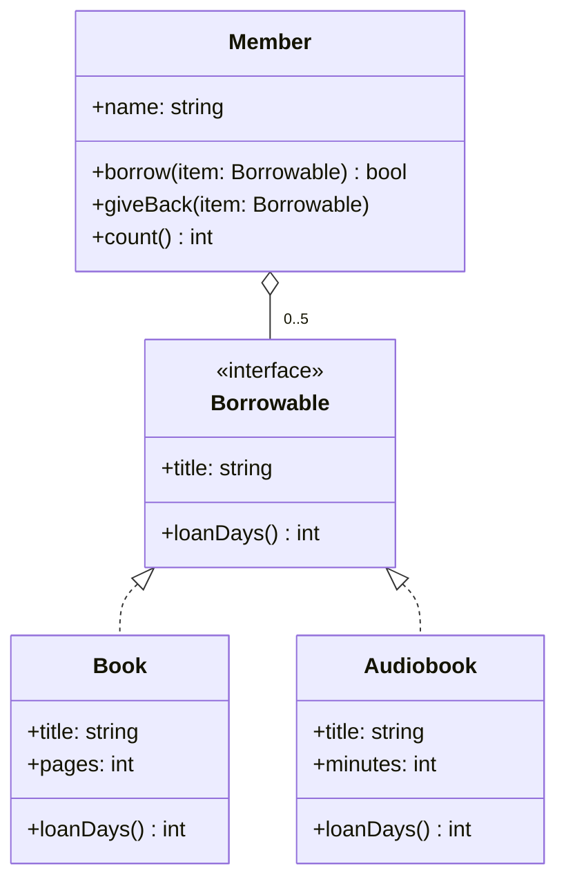

# Exercise: Code from a Class Diagram

Exercise code for the lesson **Exercise: Code from a Class Diagram** in the course *Design Patterns, Demystified* on [ask-codey.com](https://www.ask-codey.com).

## The ticket

> **From:** Priya, Riverside Library's app team
>
> At Monday's planning meeting we agreed on the class diagram below for the library's media. Sam started turning it into code before his vacation: `Borrowable` and `Book` are done, `Audiobook` is typed in but its loan days aren't, and `Member` is still the version from when we only lent books. Please finish the code so it matches the diagram:
>
> 1. **Books go out for 14 days, audiobooks for 7.**
> 2. **A member can borrow any item the library lends**, up to 5 at a time. A sixth is refused until something comes back.
> 3. **Giving an item back makes room** for another.
>
> Everything that works today has to keep working. The checkout desk already calls `borrow`, and the returns desk already calls `giveBack`.

## The diagram

GitHub draws this for you when you open the README there. In VS Code, open the Markdown preview (**Ctrl+Shift+V**, or **Cmd+Shift+V** on a Mac) with the *Markdown Preview Mermaid Support* extension installed.



The same diagram in words:

- **«interface» Borrowable**: `+ title: string`, `+ loanDays(): int`. The promise every item the library lends keeps.
- **Book** keeps the Borrowable promise (a dashed line with a hollow triangle): `+ title: string`, `+ pages: int`, `+ loanDays(): int`.
- **Audiobook** keeps the Borrowable promise too: `+ title: string`, `+ minutes: int`, `+ loanDays(): int`.
- **Member**: `+ name: string`, `+ borrow(item: Borrowable): bool`, `+ giveBack(item: Borrowable)`, `+ count(): int`.
- **Member to Borrowable**: a line with a hollow diamond at the `Member` end and `0..5` at the `Borrowable` end. A member holds 0 to 5 items; the items belong to the library and live on without the member.

## Pick your language

The same exercise is here in five languages. Work in the folder for the language you set up; you only need one.

| Folder | The library's code | The tests |
|---|---|---|
| `csharp/` | `LibraryMedia/Library.cs` | `LibraryMedia.Tests/LibraryTests.cs` |
| `java/` | `src/main/java/` (`Borrowable.java`, `Book.java`, `Audiobook.java`, `Member.java`) | `src/test/java/LibraryTest.java` |
| `python/` | `library.py` | `test_library.py` |
| `javascript/` | `library.js` | `library.test.js` |
| `typescript/` | `library.ts` | `library.test.ts` |

Each language writes the diagram's names its own way: C# names the interface `IBorrowable` and uses capitals (`LoanDays`, `GiveBack`), and Python uses underscores (`loan_days`, `give_back`). JavaScript has no interfaces, so there "keeps the Borrowable promise" means "has a `title` and a `loanDays()` method".

Every folder also has a small demo program, one member's visit to the library. You don't need to change the tests or the demo.

## Run it and check your work

Open your language's folder in VS Code (**File > Open Folder**), then open its terminal (**Terminal > New Terminal**) and run these commands there.

**C#**

```bash
dotnet run --project LibraryMedia
dotnet test
```

**Java** (the Maven Wrapper downloads Maven the first time, so the first run takes a minute)

```bash
java src/main/java/Demo.java
./mvnw test
```

On Windows in PowerShell, write `.\mvnw test` instead of `./mvnw test`.

**Python** (once: make a virtual environment and install pytest into it)

```bash
python -m venv .venv
```

Then turn it on: `.venv\Scripts\Activate.ps1` in PowerShell on Windows, or `source .venv/bin/activate` on macOS (where the command is `python3`, not `python`). Then:

```bash
pip install -r requirements.txt
python demo.py
python -m pytest
```

**JavaScript**

```bash
node demo.js
npm test
```

**TypeScript** (once: `npm install`, which installs TypeScript)

```bash
node demo.ts
npm test
```

At first, 5 tests pass and 4 fail. The 5 that pass are what the code does today: keep them green the whole time, and run the tests after every small change. The 4 that fail are the ticket. A failing test's message starts with **Not yet:** (or **Keep this working:** if you broke something that worked) and says what it expected.

## When you're done

All 9 tests are green, and the demo prints:

```text
The Lighthouse Keeper: 14 days
Rivers of Glass: 7 days
Maya borrows 2 items: yes, yes
Then 3 more: yes, yes, yes
And a sixth: no
After giving one back: yes
```

<details>
<summary>Stuck?</summary>

- **Audiobooks:** the diagram doesn't say how many days; the ticket does. One line.
- **Any item:** follow the line out of `Member`. It ends at `Borrowable`, not at `Book`, so the list a member keeps holds Borrowables, and `borrow` takes any of them without asking which kind it is.
- **Five at a time:** `0..5` at the `Borrowable` end is a rule `borrow` has to keep: count first, and refuse the sixth.
- **Giving back:** the hollow diamond says the items aren't the member's to make or destroy. They're handed in, and giving one back takes it out of the member's list; the item itself goes back on the library's shelf.

</details>

## Hand it in

When it works, push your solution to a public repo of your own on GitHub, then paste that repo's address into **Submit your exercise** on the lesson page at [ask-codey.com](https://www.ask-codey.com). That's what completes the lesson. The lesson page shows the Git commands, step by step.
